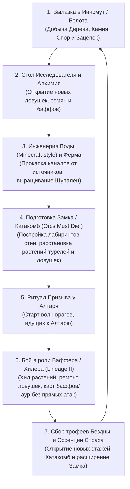

# Целевая Архитектура Игры FarmLoveCraft (`TARGET_ARCHITECTURE.md`)

Данный документ описывает целевую (target) программную и геймплейную архитектуру **FarmLoveCraft** (Bevy 0.20, Rust Edition 2024) и служит пошаговым руководством (blueprint) для эволюции текущего прототипа в полноценную игру.

---

## 1. Видение проекта, Игровой цикл и Ключевые столпы (Core Pillars)

**FarmLoveCraft** — это изометрическая 3D-игра в сеттинге Г. Ф. Лавкрафта (Иннсмут / Аркхэм 1920-х, эстетика **Low-Poly / Retro PS1**), объединяющая четыре жанровых направления в единый игровой цикл:

1. **Оккультный Симулятор Фермы + Вода по правилам Minecraft**:
   * Игрок создает **источники воды** (Колодцы Бездны, открытые шлюзы канала, подземные ключи) и прокапывает русла в терраформируемом рельефе. Вода физически растекается от источника по ступеням вниз и в стороны (от уровня `8` в источнике до `1` на краях потока, с водопадами при перепаде высот).
   * В проточной воде и орошаемой почве выращиваются **Щупальца**, **Споровые капсулы**, **Хищные корни** и **Искаженные древа**, которые служат одновременно экономическими культурами (производят **Страх/Споры** и семена) и **боевыми био-турелями / ловушками**.
2. **Вылазки за ресурсами и уликами (Resource Expeditions)**:
   * Сыщик покидает безопасный периметр своего Замка и отправляется в опасные кварталы Иннсмута, порт, болота, заброшенные особняки, склепы и процедурные пустоши Древних.
   * Цель вылазок — рубка редкой древесины, разбор руин на готический камень, поиск **Зацепок (Улик)**, гримуаров (`prop_occult_book.glb`), семян древней флоры и артефактов для прокачки.
3. **Песочница и Модульное Строительство с физикой опоры (Valheim-style Sandbox)**:
   * Полная разрушаемость любого объекта мира и честная система структурной целостности (`StructuralIntegrity` от фундамента до крыши).
   * Свободная перестройка своего Замка, возведение укреплений, лабиринтов стен, балконов, мостов, колодцев и инженерных коридоров смерти.
4. **Оборона Замка и Катакомб в духе «Plants vs. Zombies» + «Orcs Must Die!» + Саппорт/Хилер из «Lineage II»**:
   * **Наша ферма — наше оружие**: выращенные растения Бездны и механические/оккультные ловушки используются для защиты Замка Исследователя, а также при зачистке новых **Катакомб, Склепов и Древних Замков**.
   * **Фаза Подготовки и Ритуал Призыва**: зайдя в Катакомбы или подготовив оборону Замка, игрок выстраивает коридоры из стен, пускает воду для питания боевых Щупалец, расставляет напольные, стеновые и потолочные ловушки, после чего активирует **Жертвенный Алтарь (`castle_altar.glb`)** — проводит **Ритуал Призыва**.
   * **Роль Игрока — Чистый Саппорт / Баффер / Инженер (Lineage II Bishop / Prophet / Warsmith)**:
     * Во время волны врагов **Сыщик НЕ атакует монстров напрямую** (топор и лопата — исключительно рабочие инструменты для добычи ресурсов и стройки).
     * Орды Глубоководных, культистов Дагона и порождений Бездны прут к Алтарю/Сыщику по коридорам и попадают в расставленные био-растения и ловушки.
     * Задача Сыщика в бою — маневрировать между линиями обороны, **чинить и перезаряжать ловушки**, **лечить (хилить) свои боевые растения**, **накладывать баффы** (ускорение атаки щупалец, ядовитые споры, укрепление баррикад, священное пламя фонаря) и кидать **дебаффы/контроль** (замедление, страх, ослепление светом фонаря) на толпы врагов.

---

### Схема основного игрового цикла (Core Loop)



---

## 2. Принципы целевой архитектуры (Bevy 0.20 ECS)

Вместо монолитных файлов в корне `src/` целевая архитектура строится по принципу **Доменных Плагинов (`Plugin`)**, **Событийно-ориентированного взаимодействия (`Event` / `Observer`)** и **Детерминированного разделения данных (`Resources` vs `Components`)**.

### 2.1. Жизненный цикл и состояния игры (`AppState` и `WavePhase`)
Вводится глобальная машина состояний `States` и фазы оборонного ритуала:

```rust
#[derive(States, Debug, Clone, Copy, Eq, PartialEq, Hash, Default)]
pub enum AppState {
    #[default]
    AssetLoading, // Предзагрузка и валидация всех GLB, шрифтов, материалов
    MainMenu,     // Титульный экран с силуэтом Ктулху и выбором сохранения/сида
    InGame,       // Основной игровой процесс
    Paused,       // Пауза / Меню настроек / Журнал расследования
}

/// Фаза игрового процесса внутри Замка / Катакомб
#[derive(SubStates, Debug, Clone, Copy, Eq, PartialEq, Hash, Default)]
#[source(AppState = AppState::InGame)]
pub enum GameplayPhase {
    #[default]
    ExplorationAndPrep, // Свободные вылазки, ферма, терраформинг воды, расстановка ловушек
    RitualDefenseWave,  // Активен Ритуал Призыва: идут волны врагов, Сыщик в режиме Баффера/Хилера
    WaveCompleted,      // Завершение ритуала, выдача наград Алтаря
}

#[derive(Resource, Debug, Clone, Copy, Eq, PartialEq, Default)]
pub enum InteractionTool {
    #[default]
    CommandAndMove,  // Навигация, контекстное RTS-меню, рубка/копка вне боя
    BuildTrapOrWall, // Голографический превью-режим постройки стен, ловушек и посадки боевых растений
    WaterEngineering,// Управление источниками воды и прокапка русел
    SupportCaster,   // Панель умений Баффера/Хилера [Q, W, E, R, 1-6] для хила ловушек и баффа фермы
}
```

### 2.2. Конвейер выполнения систем (`SystemSet`)
Все системы кадра (`Update` и `FixedUpdate`) строго распределены по конвейеру фаз, что позволяет параллелить независимые расчёты:


---

## 3. Целевая модульная структура проекта (`src/`)

Текущие 8 файлов эволюционируют в чистую модульную иерархию плагинов:

```text
src/
├── main.rs                  # Точка входа, инициализация App и подключение плагинов
├── lib.rs                   # Реэкспорт модулей для интеграционных тестов и бенчмарков
├── core/                    # Ядро: состояния, расписания, общие константы
│   ├── mod.rs               # CorePlugin
│   ├── state.rs             # AppState, GameplayPhase, InteractionTool, GameSystemSet
│   └── assets.rs            # Реестр предзагруженных GLB-хэндлов, шрифтов и SharedVfxAssets
├── world/                   # Окружение, чанки, биомы, вода (Minecraft-style) и данжи
│   ├── mod.rs               # WorldPlugin
│   ├── terrain.rs           # WorldTerrain, чанковый стриминг (load/unload), мешинг
│   ├── water_cellular.rs    # Клеточный автомат воды в стиле Minecraft (Source -> Flowing 8..1)
│   ├── biomes.rs            # Правила генерации диких биомов для вылазок за ресурсами
│   ├── dungeons/            # Генератор и префабы Катакомб, Склепов и Замков для обороны
│   │   ├── mod.rs
│   │   ├── castle_hub.rs    # Замок Исследователя (главная база и ферма)
│   │   ├── catacombs.rs     # Многоуровневые Катакомбы со спавнерами волн и Алтарем Призыва
│   │   └── town_innsmouth.rs# Улицы Аркхэма/Иннсмута и порт для ресурсных вылазок
│   └── persistence.rs       # Сохранение/загрузка дельт мира, воды, ловушек и прогресса
├── navigation/              # Пространственный индекс, коллизии, A* и Flow Field для орд
│   ├── mod.rs               # NavigationPlugin
│   ├── spatial_grid.rs      # Быстрая хэш-сетка коллайдеров, врагов и ловушек по ячейкам O(1)
│   ├── collider.rs          # ColliderRect, StairLink, FloorElevationZone
│   ├── pathfinder.rs        # Многоэтажный A* для Сыщика и одиночных целей
│   └── flow_field.rs        # Векторное поле пути (Flow Field) от спавнеров к Алтарю для сотен врагов
├── building/                # Архитектура зданий, структурная опора и срезание стен
│   ├── mod.rs               # BuildingPlugin
│   ├── registry.rs          # BuildingRegistry, ActiveBuildingState, этажи и Катакомбы
│   ├── cutaway.rs           # Система прозрачности стен/мебели с кэшем CutawayStateCache
│   ├── integrity.rs         # Граф структурной опоры Valheim (локальный волновой расчет)
│   └── placement.rs         # Привязка к сокетам (Snap Points), Ghost Preview ловушек и стен
├── defense_traps/           # Механика PvZ + Orcs Must Die (Ферма-Оружие, Ловушки, Волны)
│   ├── mod.rs               # DefensePlugin
│   ├── ritual_spawner.rs    # Алтарь Призыва, расписание волн, порталы врагов в Катакомбах
│   ├── enemies.rs           # ИИ толп врагов (Глубоководные, Культисты, Гончие), движение в ловушки
│   ├── plant_turrets.rs     # Боевые растения фермы (Щупальца-хлысты, Споровые мортиры, Корни-путы)
│   └── traps.rs             # Инженерные/оккультные ловушки (шипы, маятники, рунические мины, прочность)
├── support_class/           # Механика Сыщика как Баффера / Хилера / Инженера (Lineage II style)
│   ├── mod.rs               # SupportClassPlugin
│   ├── buffs_auras.rs       # Компоненты ActiveBuffs, таймеры баффов (Haste, Might, Shield, Regen)
│   ├── healer_skills.rs     # Заклинания исцеления растений, массового ремонта ловушек и баффа турелей
│   └── lantern_aura.rs      # Аура Керосинового Фонаря (ослабление врагов, бафф союзных спор)
├── combat_destruction/      # Разрушаемость мира, добыча на вылазках, осколки и физический лут
│   ├── mod.rs               # DestructionPlugin
│   ├── destructible.rs      # Компонент Destructible, типы материалов, таблицы дропа
│   ├── vfx.rs               # Пул частиц щепок/осколков, лучей хила/баффа, HitShake
│   └── loot.rs              # DroppedLoot, физика дуги разлета и магнитный сбор
└── ui_camera/               # Изометрическая камера, контекстное меню, панель баффов и HUD
    ├── mod.rs               # UiCameraPlugin
    ├── camera.rs            # CameraController, плавный фокус по этажам и Катакомбам
    ├── hud.rs               # HUD ресурсов, статуса волны Ритуала, маны/веры Сыщика
    ├── skillbar_ui.rs       # Панель скиллов Баффера/Хилера и хоткеев ловушек (Lineage/OMD style)
    └── context_menu.rs      # Контекстное RTS-меню ПКМ для мирных работ и подготовки обороны
```

---

## 4. Детальное проектирование ключевых подсистем

### 4.1. Симуляция Воды по правилам Minecraft (`world/water_cellular.rs`)

Вода в **FarmLoveCraft** работает как дискретный клеточный автомат на сетке рельефа (с шагом узлов `TERRAIN_STEP = 2.0 м`), полностью повторяя логику **Minecraft**:

1. **Уровни воды (`WaterLevel: u8` от `0` до `8`)**:
   * `0` — сухо;
   * `8` — **Блок-Источник (`WaterSource`)**: создается игроком при постройке Проклятого Колодца, открытии шлюза канала, установке Водного Монолита или в природных родниках болот. Источник никогда не иссякает сам по себе.
   * `7..=1` — **Текущая вода (`FlowingWater`)**: распространяется от источника по соседним ячейкам.
2. **Правила распространения (FixedUpdate тик каждые `0.25 сек`)**:
   * **Течение вниз (Водопад / Углубление)**: если соседняя клетка `(nx, nz)` имеет высоту дна $h_{\text{next}} < h_{\text{curr}} - 0.35\text{ м}$, вода стекает туда и получает максимальный напор потока (`level = 8`, флаг `falling = true`), от которого на дне ямы/траншеи снова может растечься на 7 клеток в стороны!
   * **Течение по горизонтали (Проточный канал)**: на ровной поверхности или плавном уклоне ($h_{\text{next}} \le h_{\text{curr}} + 0.05\text{ м}$) вода перетекает в соседние 4 клетки (Север, Юг, Запад, Восток) с уровнем `new_level = current_level - 1`.
   * **Правило бесконечного источника (как в Minecraft `2×2`)**: если пустая клетка в выкопанном резервуаре имеет $\ge 2$ ортогональных соседей со статусом **Блок-Источник (`level == 8`)** на той же высоте, она сама становится **Блоком-Источником (`level = 8`)**!
   * **Осушение**: если игрок засыпает русло землей (`TerrainOp::Raise`) или сносит источник, клетки текущей воды, потерявшие подпитку от более высокого уровня, плавно убывают на `-1` за тик до полного высыхания.
3. **Геймплейная роль проточной воды**:
   * **Питание Фермы и Боевых Растений**: Щупальца Бездны и Споровые башни требуют наличия текущей воды (`level >= 1`) в своей или соседней клетке. Чем сильнее поток (`level`), тем выше скорость роста и базовый реген здоровья растения.
   * **Тактический вектор потока в Катакомбах**: вектор течения воды ($\vec{v}_{\text{flow}}$ от большего уровня к меньшему) физически **сносит/замедляет врагов**, идущих против течения, или **заталкивает их прямо в ловушки**, если прокопать канал в сторону пропасти или шипов!
   * **Проводник баффов**: если Сыщик кидает алхимический бафф или освящение в **Источник воды**, эффект по течению передается всем растениям, растущим вдоль этого водного канала.


---

### 4.2. Ферма как Оружие и Защита Замка/Катакомб («Plants vs. Zombies» + «Orcs Must Die!»)

Вся продукция фермы и строительства делится на **Экономические культуры**, **Боевые растения-турели (PvZ)** и **Инженерно-оккультные ловушки (OMD)**:

| Категория | Название | Модель / База | Требования (Вода / Ресурсы) | Роль в обороне Замка и Катакомб |
| :--- | :--- | :--- | :--- | :--- |
| **Растение (PvZ)** | **Хлыстовое Щупальце** | `outdoor_canal.glb` / `outdoor_bush.glb` | Вода (`Level >= 1`), `1 Земля`, `2 Споры` | Бьет по площади всех врагов, проходящих по каналу или вдоль него; в мирное время дает урожай Спор |
| **Растение (PvZ)** | **Споровая Мортира** | `outdoor_tree_snag.glb` + капсулы спор | Орошаемая почва, `2 Дерева`, `4 Споры` | Стреляет навесом биолюминесцентными сгустками по толпам врагов, накладывая коррозию брони |
| **Растение (PvZ)** | **Корни-Ловчие (Удерживатель)** | Болотный куст с корнями | Вода (`Level >= 2`), `2 Листвы`, `2 Споры` | Опутывает и останавливает врагов прямо на клетках с ударными ловушками |
| **Растение (PvZ)** | **Искаженное Древо-Страж** | `outdoor_tree_corrupted.glb` | Источник воды рядом, `5 Земли`, `8 Спор`, `2 Зацепки` | Крупный органический танк-барьер с пульсирующим оком: стягивает агро толпы на себя и пульсирует аурой Страха |
| **Ловушка (OMD)** | **Напольная Плита Шипов / Рунический Капкан** | Модификация `castle_floor.glb` | Ставится на пол коридора (`3 Камня`, `2 Споры`) | Срабатывает при наступании врагов, нанося огромный урон, но **теряет заряды прочности** (требует ремонта от Сыщика) |
| **Ловушка (OMD)** | **Стеновой Гарпун / Огненный Рельеф** | Навесной модуль на `castle_wall.glb` | Ставится на стены коридора (`3 Камня`, `2 Дерева`) | Отстреливает или отбрасывает врагов поперек коридора (в воду или в пропасть) |
| **Ловушка (OMD)** | **Врата-Решетка (Баррикада)** | `castle_arch.glb` (portcullis) | Ставится в проемах (`4 Камня`, `2 Дерева`) | Перекрывает прямой путь, заставляя ИИ врагов идти в длинный обход через лабиринт с ловушками и каналами |

---

### 4.3. Катакомбы, Древние Замки и Ритуал Призыва (`world/dungeons/` & `defense_traps/`)

Помимо защиты главного Замка Исследователя, в мире генерируются и размещаются **входимые Катакомбы, Склепы (`outdoor_crypt.glb`), Собор Ордена Дагона (`outdoor_church.glb`) и Заброшенные Замки**:

1. **Вход и Фаза Подготовки (`ExplorationAndPrep`)**:
   * Сыщик заходит в Катакомбы или Замок. Внутри находятся **Древний Алтарь Призыва** (точка, которую нужно защитить) и **Врата Бездны / Разломы** (точки, откуда пойдут волны врагов).
   * Между Разломами и Алтарем отображается предпросмотр маршрута врагов (золотисто-багровая линия потока).
   * Пока Ритуал не начат, врагов нет: игрок свободно изучает залы, перестраивает стены и баррикады (меняя маршрут врагов), ставит источники воды, прокапывает водные каналы, высаживает боевые Щупальца и монтирует ловушки на пол и стены.
2. **Запуск Ритуала Призыва (`RitualDefenseWave`)**:
   * Когда оборона готова, игрок активирует Алтарь (`ПКМ -> Провести Ритуал Призыва`).
   * Из Разломов начинают идти волны врагов (по 20–100+ существ за волну).
   * Для идеальной производительности все враги двигаются к Алтарю по предвычисленному **Flow Field (Векторному полю пути)** за $O(1)$ на каждого монстра, огибая построенные игроком стены и попадая в подготовленные коридоры с водой и ловушками.
   * Если враги доходят до баррикады или боевого растения, они пытаются прогрызть/сломать их.

---

### 4.4. Сыщик как Баффер / Хилер / Инженер в стиле «Lineage II» (`support_class/`)

Главное уникальное правило боевой системы: **у Сыщика нет прямых атакующих скиллов или автоатаки по врагам**. Его геймплей во время волны — это высокодинамичная игра за саппорта (как **Bishop / Elven Elder / Prophet / Warsmith** в Lineage II):

1. **Ресурс каста**: **Концентрация / Масло Фонаря / Эссенция Спор** (восстанавливается от работающих алхимических реторт и при гибели врагов в ловушках).
2. **Арсенал умений Сыщика (Панель быстрого доступа `[1]–[6]` + целевые касты ЛКМ/ПКМ по своим постройкам)**:

| Слот | Название умения (Архетип Lineage II) | Цель каста | Эффект в бою |
| :--- | :--- | :--- | :--- |
| **`[1]`** | **Живительный Ихор (Greater Heal / Battle Heal)** | Боевое растение или Древо-Страж | Мгновенно восстанавливает большой объем HP поврежденному растению/щупальцу, которое грызут враги |
| **`[2]`** | **Мастерская Починка (Warsmith Repair / Recharge)** | Механическая или руническая ловушка | Восстанавливает заряды и прочность ловушки, мгновенно перезаряжая её прямо перед носом следующей пачки монстров |
| **`[3]`** | **Печать Ярости Бездны (Prophet Haste + Empower)** | Одно растение или **Источник воды** (передается по каналу!) | На `20 сек` увеличивает скорость атаки Щупалец и Споровых мортир на $+50\%$ и их урон на $+35\%$ |
| **`[4]`** | **Эгида Каменщика (Chant of Shielding)** | Стены, Баррикады и Растения в радиусе `8 м` | Накладывает поглощающий щит и увеличивает броню укреплений на $+60\%$, не давая боссам пробить коридор |
| **`[5]`** | **Вспышка Керосинового Фонаря (Turn Undead / Mass Fear)** | Область вокруг Сыщика (`6 м`) | Ослепляет и пугает толпу врагов, заставляя их на `3 сек` пятиться назад — **повторно прогоняя их через те же ловушки и щупальца!** |
| **`[6]`** | **Благословение Алтаря (Mass Resurrection / Overdrive)** | Все ловушки и растения в зале (Ультимейт) | Воскрешает увядшие за волну растения, полностью заряжает все ловушки и включает максимальный напор во всех каналах |

---

### 4.5. Иерархия Скиллов и Прогрессия Сыщика (`gameplay/progression.rs`)

Древо прокачки за Столом Исследователя (`castle_table.glb`) за счет добытых на вылазках **Зацепок (`Clues`)**, **Спор (`Fear`)** и **Камня/Дерева** делится на 4 специализированные ветки:

| Ветка прогрессии | Открываемые навыки и чертежи |
| :--- | :--- |
| **1. Вылазки и Инженерия Рельефа** | • **Закаленный Топор и Кирка**: $+60\%$ к скорости добычи ресурсов на вылазках в городе и лесу.<br>• **Гидроинженер (Minecraft Water Mastery)**: открытие чертежа *Бесконечного Источника Воды*, увеличение ширины и глубины прокапываемых каналов. |
| **2. Селекция Боевой Фермы (PvZ)** | • **Шипастые Щупальца**: Щупальца в проточной воде наносят кровотечение и бьют на 2 клетки дальше.<br>• **Кислотные Споры**: Споровые мортиры оставляют на полу лужи, замедляющие врагов.<br>• **Симбиоз**: растения, стоящие в одной водной сети, делятся входящим исцелением от Сыщика. |
| **3. Фортификация и Ловушки (OMD)** | • **Готическая Инженерия**: $+30\%$ к структурной опоре зданий (`StructuralPiece`), открытие решеток-баррикад и стеновых гарпунов.<br>• **Авто-взвод**: ловушки получают $+50\%$ к запасу зарядов до поломки и наносят двойной урон по замедленным водой врагам. |
| **4. Искусство Баффера и Хилера (Lineage II)** | • **Мастерство Проводника Воды**: любой бафф или хил, брошенный Сыщиком в Источник воды, распространяется по всему проточному каналу на все растения со штрафом всего $15\%$.<br>• **Негасимый Фонарь Иннсмута**: увеличивает радиус пассивной ауры фонаря Сыщика (реген маны, подсветка уязвимых мест врагов для ловушек). |

---

## 5. Пошаговый план реализации (Roadmap до целевого вида)

Ниже представлен упорядоченный план работ, по которому проект планомерно дорабатывается от текущего состояния до полноценной игры:

### Фаза 1: Рефакторинг архитектуры и внедрение ядра оптимизации
* **Шаг 1.1**: Разбить монолитный `src/world.rs` (1 877 строк) на модули `world/dungeons/castle_hub.rs`, `world/dungeons/town_innsmouth.rs` и `world/biomes.rs`.
* **Шаг 1.2**: Оформить подсистемы в виде отдельных Bevy `Plugin` с параллельными `SystemSet` (согласно разделу 2.2 и `OPTIMIZATION_PLAN.md`).
* **Шаг 1.3**: Внедрить пространственный индекс `SpatialGrid` в `NavWorld` ($O(1)$ поиск коллайдеров, ловушек и врагов в клетке), кэш `CutawayStateCache` для стен и `SharedVfxAssets` для частиц/лута.
* **Шаг 1.4**: Реализовать выгрузку далеких чанков (`Chunk Unloading`) с сохранением дельт раскопок и построек.

### Фаза 2: Вода по правилам Minecraft и Боевая Ферма
* **Шаг 2.1**: Реализовать `water_cellular.rs` — клеточный автомат воды (источник `level = 8`, растекание `7..1`, стекание по уступам с обновлением напора, правило `2×2` бесконечного источника и визуализация водной глади с вектором течения).
* **Шаг 2.2**: Связать рост и боевой режим растений (`TentacleCrop`, `SporeMortar`, `EntanglingRoots`) с уровнем воды в клетке.
* **Шаг 2.3**: Добавить интерактивный режим размещения построек и ловушек (`Ghost Preview` с вращением по `[R]`, привязкой к сетке/сокетам и отображением структурной опоры).

### Фаза 3: Катакомбы, Ритуал Призыва и Орды врагов (PvZ + Orcs Must Die!)
* **Шаг 3.1**: Реализовать генератор/префаб **Катакомб** (вход через Склеп или подземелье Замка) с Алтарем Призыва и порталами врагов.
* **Шаг 3.2**: Внедрить `FlowField` (векторное поле навигации от порталов к Алтарю), которое пересчитывается при постройке/сносе стен и предсказывает маршрут волны.
* **Шаг 3.3**: Реализовать спавнер волн при активации Алтаря (`RitualDefenseWave`), ИИ врагов, снос врагов течением воды в каналах и срабатывание ловушек/растений-турелей.

### Фаза 4: Геймплей Саппорта/Хилера (Lineage II style), Древо Скиллов и Полировка
* **Шаг 4.1**: Реализовать систему баффов, хила и ремонта (`SupportClassPlugin`): панель скиллов `[1]–[6]`, визуальные эффекты каста хила/баффов на растения и ловушки, а также передачу баффов вниз по течению водного канала.
* **Шаг 4.2**: Реализовать интерфейс Стола Исследователя для открытия новых ловушек, видов растений и усилений баффов за счет собранных на вылазках Зацепок (`Clues`) и Спор (`Fear`).
* **Шаг 4.3**: Добавить сохранение/загрузку мира и атмосферную полировку Иннсмута (туман, звуки/визуал потока воды в каналах, свечение баффов на щупальцах и силуэт Ктулху во время Ритуала Призыва).
