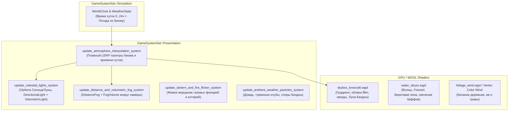

# План визуального апгрейда `FarmLoveCraft`: Секрет стиля Valheim + Лавкрафтовская атмосфера (Bevy 0.20)

> **Статус документа**: Архитектурный и художественный план (без изменения кода на данном этапе).  
> **Целевой стек**: Rust 2024 + Bevy `0.20.0` (PBR, Post-Processing, Volumetric Lighting, Atmospheric Fog, WGSL Shaders).

---

## ЧАСТЬ 1. Что именно заставляет Valheim выглядеть так красиво?

Феномен **Valheim** заключается в контрасте: игра использует намеренно **низкополигональную геометрию (low-poly)** и **пиксельные текстуры низкого разрешения (point/nearest filtering)** без сложных карт микрорельефа, но поверх них работает **современный физически корректный конвейер освещения и пост-обработки**.

Мозг человека считывает «красоту» и «атмосферность» сцены не по числу треугольников на модели стула, а по **макро-признакам среды**: как воздух рассеивает свет, как солнце пробивает кроны деревьев, как блестит мокрая поверхность и как объекты растворяются в глубине кадра.

Деконструкция визуальной формулы **Valheim** (адаптированной под наш сеттинг Аркхэма / Иннсмута):

| № | Секретный ингредиент Valheim | Как это работает визуально | Что сейчас в `FarmLoveCraft` |
| :- | :--- | :--- | :--- |
| **1** | **Атмосферный и высотный туман с анизотропным рассеиванием (Mie / Directional Inscattering)** | Туман не просто «серый». Когда смотришь в сторону солнца/луны сквозь туман, воздух светится золотым или лазурным ореолом; в противоположной стороне — густая холодная синева. Низины и вода окутаны плотной дымкой. | Туман отсутствует полностью. Дальние чанки (`CHUNK_STREAM_RADIUS = 5`) обрываются резким краем в черную пустоту дефолтного `ClearColor`. |
| **2** | **Объемные лучи света (God Rays / Volumetric Fog & Crepuscular Rays)** | Лучи солнца и луны физически рассеиваются в лесном тумане, пробиваясь сквозь ветви сосен (`outdoor_tree_pine.glb`), крыши готических соборов и кованые ограды. | Только прямой `DirectionalLight` с базовыми тенями (`shadow_maps_enabled: true`) без объемного рассеивания. |
| **3** | **Динамический цикл дня/ночи и смена погодных состояний по биомам** | Каждая минута суток имеет собственную цветовую палитру: кроваво-янтарный закат, туманный сизый рассвет, бархатная звездная ночь с гигантским светилом/древом в небе, шторм с молниями. | Статичный `DirectionalLight` (`illuminance: 3_000.0`, фиксированный угол `(25, 40, 25)` в `src/world.rs:824`). Время суток и погода по биомам (`Biome` в `src/terrain.rs:63`) не меняют свет. |
| **4** | **Мягкий HDR Bloom + Кинематографический Tonemapping + Цветокоррекция** | Окна таверн, жаровни, факелы, зеленые ритуальные кристаллы и блики на воде дают мягкое кинематографическое свечение (HDR > 1.0 + `Bloom`), а `TonyMcMapface` / `AgX` сохраняет глубокие тени без кислотного пересвета. | На `Camera3d` (`src/world.rs:836`) не подключены `Bloom`, `Tonemapping`, `ColorGrading`, `DepthOfField` и `ScreenSpaceAmbientOcclusion`. |
| **5** | **Контраст «Холодная тьма vs Теплый очаг» (Color Temperature Contrast)** | Вся среда построена на классическом комплементарном контрасте: холодный сине-изумрудный окружающий свет (`AmbientLight` + луна) против теплого янтарного огня фонарей (`PointLight` 2200K) и зловещего биолюминесцентного неона Бездны. | Точечные источники света расставлены (`src/world.rs:680-713`), но из-за отсутствия Bloom, тумана и настроенного AmbientLight/Shadow Bias они выглядят просто как светлые пятна на полу. |
| **6** | **Процедурный Skybox с облаками, звездами и космическим ориентиром** | Небо — это не плоская заливка, а живой купол с градиентом горизонта, плывущими облаками, созвездиями и гигантским мифологическим силуэтом в небе (в Valheim — ветви Иггдрасиля, у нас — созвездия Древних, туманность Каркозы и силуэт Ктулху на горизонте). | Камера рендерит стандартный серый/черный фон вокруг чанков. |
| **7** | **Живая среда: ветер в кронах (Vertex Wind), частицы в воздухе и бликующая вода** | Даже когда игрок стоит на месте, кадр дышит: качаются ветви ив и сосен, в воздухе плывут споры, светлячки, пепел и капли дождя, а вода отражает небо и фонари с пеной у берегов. | Деревья и кусты абсолютно неподвижны; вода (`src/water_cellular.rs`) — простой полупрозрачный `StandardMaterial` без волн Герстнера, пены глубины и нормалей ряби. |

---

## ЧАСТЬ 2. Архитектура системы визуализации (`src/atmosphere.rs` и шейдеры)

Чтобы сохранить высокую производительность (60+ FPS на нативе и в WASM) и чистоту ECS-архитектуры (в соответствии с `GameSystemSet::Presentation` в `src/main.rs:50`), все визуальные системы объединяются в новый модуль **`src/atmosphere.rs`** и набор WGSL-шейдеров в **`assets/shaders/`**.

---

## ЧАСТЬ 3. Поэтапный план реализации (8 фаз)

### Фаза 1. Камера, HDR, Tonemapping, Bloom и SSAO (`src/camera.rs`, `src/world.rs`)
**Цель**: Перевести рендер камеры на кинематографический HDR-пайплайн, чтобы свет фонарей, окон Аркхэма и оккультных кристаллов обрел мягкое свечение, а стыки стен и брусчатки — глубокие контактные тени.

1. **Настройка `Camera3d` в `src/world.rs:835`**:
   - Включить HDR-рендеринг камеры (`Hdr` компонент / настройка пайплайна Bevy 0.20).
   - Добавить **`Tonemapping::TonyMcMapface`** (или `AgX`) — дает мягкий пленочный переход в светах без выжигания цветов в белый.
   - Добавить **`Bloom`**:
     - `intensity: 0.22` (мягкий туманный ореол вокруг газовых фонарей и окон `PS1_WindowWarm`),
     - `low_frequency_boost: 0.65`,
     - `high_pass_frequency: 0.85`,
     - `composite_mode: BloomCompositeMode::EnergyConserving`.
   - Добавить **`ColorGrading`**:
     - Слегка приглушенная насыщенность в тенях (холодный сине-зеленый сдвиг `shadows`), теплый янтарный оттенок в средних тонах (`midtones`) и повышенный контраст.
2. **Контактные тени и сглаживание (SSAO + Anti-Aliasing)**:
   - Подключить **`ScreenSpaceAmbientOcclusion` (SSAO)** (`QualityLevel::Medium` / `High`) + **`TemporalAntiAliasing` (TAA)** или `Msaa::Sample4` / `Fxaa`.
   - Это мгновенно «приземлит» все объекты (`outdoor_bench`, `outdoor_townhouse`, надгробия, ящики в порту) к рельефу, убрав эффект «парящих над землей моделек».
3. **Эффект Tilt-Shift / Depth of Field (опционально по зуму)**:
   - В `camera_controller_system` (`src/camera.rs:62`): при отдалении камеры на большой зум (RTS-обзор) слегка ослаблять DoF, а при приближении к Сыщику (`distance < 14.0`) включать мягкое размытие дальнего фона (`DepthOfField` в режиме `Gaussian` / `Bokeh`), как в Valheim и Diablo IV.

---

### Фаза 2. Атмосферный туман в стиле Valheim (`DistanceFog` + Анизотропное свечение)
**Цель**: Скрыть границу подгрузки чанков (`CHUNK_STREAM_RADIUS = 5`, т.е. `80 м`) и создать густую перспективу воздушной дымки, меняющую цвет от направления на солнце/луну.

1. **Компонент `DistanceFog` на `Camera3d`**:
   - Использовать **`FogFalloff::Atmospheric { extinction, inscattering }`** (или комбинированный `ExponentialSquared` с `directional_light_color`):
     - `color`: глубокий сланцево-синий / болотно-сизый цвет горизонта (динамически меняется по времени суток и биому).
     - `directional_light_color`: золотисто-янтарный на закате / бледно-изумрудный ночью (`alpha: 0.65`).
     - `directional_light_exponent: 12.0..24.0` — создает тот самый эффект Valheim, когда взгляд в сторону светила заливает экран мягким свечением сквозь деревья!
   - Дистанция полного слияния с небом привязывается к `(CHUNK_STREAM_RADIUS as f32 - 0.8) * CHUNK_SIZE` (`~65–72 м`), чтобы подгрузка новых чанков в `stream_terrain_chunks_system` происходила абсолютно незаметно внутри густого тумана.
2. **Низинный болотный туман (Ground Mist Layers)**:
   - В низинах рельефа (`y < 0.6`), над каналами воды (`WaterWorld`) и на болотах (`Biome::InnsmouthSwamp`) спавнить полупрозрачные слои приземного тумана с плавным затуханием по высоте (Depth-Fade / Soft Particles), через которые по колено бредет Сыщик.

---

### Фаза 3. Объемный свет и Божественные лучи (God Rays / Volumetric Lighting)
**Цель**: Сделать воздух осязаемым — лучи луны и заката должны прорезать кроны деревьев, шпили собора Дагона и крыши таунхаусов.

1. **Включение `VolumetricFog` и `VolumetricLight` (встроенный модуль `bevy::pbr` / `bevy::light`)**:
   - На `Camera3d` добавить компонент **`VolumetricFog`**:
     - `ambient_intensity: 0.0` (чтобы объемный туман освещался именно реальными источниками света),
     - `step_count: 32..48`,
     - `jitter: 0.8` (сглаживание ступенек реймаршинга).
   - На главный `DirectionalLight` (Солнце / Луна) добавить маркер **`VolumetricLight`** и настроить каскады теней (`CascadeShadowConfigBuilder` с 4 каскадами от `0.1 м` до `85.0 м`).
   - Вокруг фокуса камеры поддерживать локальный объем **`FogVolume`**:
     - `density_factor: 0.035..0.08` (зависит от биома: в `InnsmouthSwamp` и `Darkwoods` плотнее, в `ArkhamCitadel` прозрачнее),
     - `scattering_asymmetry: 0.65` (фазовая функция Хеньи-Гринштейна — усиливает яркость лучей при контровом свете сквозь ветви деревьев).
2. **Локальные конусы света у уличных фонарей и маяков**:
   - Для уличных газовых фонарей (`outdoor_lamppost.glb`) и прожектора на траулере/часовой башне добавить легкие полупрозрачные конусы объемного свечения (Fake Volumetric Halo Mesh с френелевским затуханием по краям — стоит 0 мс на GPU и дает идеальный викторианский туман вокруг каждого фонаря).

---

### Фаза 4. Процедурный Skybox Лавкрафта (`assets/shaders/skybox_lovecraft.wgsl`)
**Цель**: Заменить пустой фон на живой купол неба, который виден при наклоне камеры, отражается в воде и задает цвет горизонта.

1. **Купол неба (Sky Dome / Procedural Skybox)**:
   - Кастомный шейдер `ExtendedMaterial` или `Material` на инвертированной сфере большого радиуса, привязанной к позиции камеры (`cam_transform.translation` без вращения):
     - **Градиент Зенит → Горизонт → Надир**: плавный переход, управляемый ресурсом `AtmosphereState`.
     - **Двухслойные процедурные облака (fBm Noise)**: медленно плывут по ветру, подсвечиваются снизу закатным солнцем или зеленоватым сиянием Луны.
     - **Звездное небо и чужие созвездия**: проявляются ночью в просветах облаков (с легким мерцанием).
     - **Диск Солнца и Огромная Луна Иннсмута**: видимые светила на небосводе, синхронизированные с вектором `DirectionalLight`.
     - **Силуэт Ктулху на горизонте (`outdoor_cthulhu.glb` в `src/world.rs:446`)**: погрузить его в плотную атмосферную дымку с периодическими далекими вспышками молний за его крыльями.
2. **Динамический `GlobalAmbientLight` / Diffuse Sky Bounce**:
   - Интенсивность и цвет `GlobalAmbientLight` плавно вычисляются из цвета зенита и горизонта скайбокса, чтобы тени днем были голубоватыми, на закате — пурпурно-синими, а ночью в катакомбах — почти черными (делая фонарь Сыщика `PlayerLanternLight` жизненно необходимым!).

---

### Фаза 5. Динамический цикл Дня и Ночи + Атмосфера Биомов (`WorldClock` & `BiomeAtmosphere`)
**Цель**: Сделать мир живым во времени и пространстве — как в Valheim, где переход из Лугов в Черный Лес или на Болота полностью меняет погоду, туман и освещение.

#### 5.1. Суточный цикл (`WorldClock`)
Плавное движение светила по небосводу с 4 ключевыми фазами (интерполяция по кривым Эрмита):

| Фаза суток | Время (`0..24`) | Свет (`DirectionalLight`) | Цвет тумана и неба | Особые эффекты |
| :--- | :---: | :--- | :--- | :--- |
| **Туманный Рассвет** | `05:00 – 08:00` | Низкий угол (`12°`), розовато-золотой (`5_500 lx`), длинные косые лучи сквозь деревья | Сиренево-серая утренняя дымка над водой | Густой туман у земли, гаснут уличные фонари Аркхэма |
| **Пасмурный День Новой Англии** | `08:00 – 17:00` | Высокий угол (`50°`), прохладный серебристо-солнечный (`14_000 lx`) | Приглушенно-голубой с тяжелыми облаками | Четкие тени, солнечные блики на воде и брусчатке |
| **Кровавый Закат (Golden/Crimson Hour)** | `17:00 – 20:30` | Угол `8°`, насыщенный багрово-янтарный (`6_500 lx`), максимальные God Rays | Пурпурно-золотой горизонт | Зажигаются газовые фонари и теплые окна домов |
| **Ночь Древних (Eldritch Night)** | `20:30 – 05:00` | Холодная лазурно-зеленоватая Луна (`2_200 lx`), угол `35°` | Глубокий черно-изумрудный туман | Яркое свечение спор, фонаря Сыщика и ритуальных алтарей |

#### 5.2. Погодные пресеты по Биомам (`src/terrain.rs: Biome`)
Когда Сыщик переходит из одного биома в другой (`terrain.sample_biome(player.x, player.z)`), система `update_atmosphere_interpolation_system` за `3.5 секунды` плавно перестраивает погоду (в точности как в Valheim):

- **`Biome::ArkhamCitadel` (Поместье и Город Аркхэма)**: умеренная осенняя дымка, теплый свет газовых фонарей, редкий моросящий дождь.
- **`Biome::InnsmouthCity` (Портовые кварталы Иннсмута)**: плотный соленый морской туман с запахом рыбы, зеленовато-бирюзовый оттенок воздуха, крики чаек и шум прибоя.
- **`Biome::InnsmouthSwamp` (Болота Иннсмута)**: солнце перекрывается тучами на 70%, густой изумрудный туман у самой земли, в воздухе кружат биолюминесцентные споры, идет болотный дождь.
- **`Biome::WitchVillage` (Оккультная Деревня Ведьм)**: фиолетово-янтарные сумерки, дым из печных труб и зеленый пар над котлами (`haunted_cauldron_large.glb`).
- **`Biome::Darkwoods` (Чащоба Черного Леса)**: глубокий полумрак под кронами, резкие контрастные лучи света (God Rays) сквозь сосны, светлячки в кустах.
- **`Biome::EldritchRuins` (Пустоши Древних)** и **Активный Ритуал Защиты (`DefenseWaveState::active` в `src/defense.rs`)**: небо багровеет/зеленеет, поднимается пепельный ветер и вспыхивают молнии Бездны.

---

### Фаза 6. Шейдер Живой Воды и Мокрых Поверхностей (`src/water_cellular.rs`)
**Цель**: Превратить клеточную воду (`WaterWorld`) из плоских полупрозрачных квадратиков в завораживающую водную гладь в духе Valheim.

1. **Кастомный материал воды (`WaterMaterial` / расширение `StandardMaterial`)**:
   - **Вершинные волны (Gerstner / Dual-Sine Waves)**: легкое покачивание вершин водной сетки по времени `globals.time`, синхронизированное с вектором течения `cell.flow_dir` (`src/water_cellular.rs:24`).
   - **Эффект Френеля и Глубины (Beer-Lambert Law)**: под прямым углом видна темная глубина канала/колодца, под острым углом вода зеркально отражает небо, луну и огни фонарей (`reflectance: 0.85`, `perceptual_roughness: 0.08`).
   - **Береговая пена и рябь**: белая/изумрудная кромка пены вдоль берегов каналов и у водопадов (`cell.falling == true`).
   - **Свечение Алхимического Баффа (`cell.buff_active`)**: когда Сыщик пускает бафф по руслу, по воде бегут светящиеся биолюминесцентные прожилки (`emissive` с HDR > 2.5 для срабатывания `Bloom`).
2. **Эффект мокрой брусчатки и крыш во время дождя**:
   - При дожде в биомах `InnsmouthSwamp` / `InnsmouthCity` плавно снижать `perceptual_roughness` материала рельефа (`terrain_mat` в `src/world.rs:74`) с `0.92` до `0.32` и повышать `reflectance`, чтобы мокрая земля и каменные мостовые отражали желтый свет уличных фонарей!

---

### Фаза 7. Живое освещение, Ветер в листве и Атмосферные частицы
**Цель**: Добавить микро-динамику в каждый квадратный метр экрана.

1. **Дыхание огня и мерцание фонарей (`FlickeringLight` компонент)**:
   - Газовые фонари (`outdoor_lamppost`), свечи канделябров (`castle_candelabra`), камины (`castle_fireplace`), тыквы (`haunted_pumpkin_jack`) и фонарь Сыщика (`PlayerLanternLight`) получают компонент `FlickeringLight { base_intensity, amplitude, speed, phase }`.
   - Система плавно модулирует `intensity` и микро-смещение позиции (`±0.03 м`) через многочастотный синус/шум Перлина — тени от мебели и колонн в замке начинают «дышать», как от настоящего живого пламени.
   - Ночью уличные фонари включаются на 100%, а днем автоматически приглушаются для экономии GPU.
2. **Ветер в кронах деревьев и кустах (Foliage Wind Sway)**:
   - Легкая система покачивания крон деревьев (`outdoor_tree_*`) и кустов (`outdoor_bush`, `InfectedFlora`) с учетом силы ветра текущего биома (или через вершинный шейдер с весом по высоте `position.y`, чтобы ствол у земли стоял неподвижно, а верхушка и ветви плавно раскачивались).
3. **Атмосферные частицы вокруг камеры (Camera-Attached Weather Volume)**:
   - Вместо спавна частиц по всему миру, создается компактный пул из 150–250 легковесных билбордов/частиц в радиусе `22 м` вокруг фокуса камеры:
     - **Дождь Новой Англии**: наклонные косые штрихи капель + круги на воде/земле.
     - **Споры и Светлячки Бездны**: медленно парящие изумрудно-золотые точки (`emissive` HDR) в лесу и у зараженной флоры (`InfectedFlora(true)`).
     - **Туманные клубы и дым из труб**: поднимаются над дымоходами (`haunted_chimney`, `Arkham_Chimney_*`) и котлами.

---

### Фаза 8. Улучшение шейдинга рельефа (Triplanar / Slope-Based Terrain Blending)
**Цель**: Убрать монотонность вершинного цвета рельефа (`src/terrain.rs`) на крутых склонах, раскопках и дорогах.

1. **Обогащение меша рельефа в `WorldTerrain::build_chunk_mesh`**:
   - Автоматический расчет крутизны склона (`1.0 - normal.y`): крутые берега каналов и раскопанные ямы (`SurfaceMod::Excavated`) получают фактуру обнаженной влажной скалы/корней.
   - Микро-вариация шероховатости и цвета вершин через высокочастотный шум, чтобы трава, болотная тина, вспаханные грядки (`SurfaceMod::Cultivated`) и брусчатка (`SurfaceMod::Paved`) имели выразительный микрорельеф при боковом свете заката и фонаря Сыщика.

---

## ЧАСТЬ 4. Производительность и сохранение 60+ FPS (Бюджет GPU)

Все визуальные улучшения проектируются с учетом уже внедренных оптимизаций (`OPTIMIZATION_PLAN.md`: `OPT-01..OPT-10`):

| Подсистема | Нагрузка на CPU | Нагрузка на GPU | Механизм оптимизации и масштабирования |
| :--- | :---: | :---: | :--- |
| **HDR + Tonemapping + Bloom** | `0.0 мс` | `~0.4 мс` | Встроенный полноэкранный проход Bevy 0.20 (Downsample/Upsample мип-цепочки). |
| **DistanceFog (Atmospheric)** | `< 0.01 мс` | `~0.1 мс` | Вычисляется аналитически во фрагментном шейдере без дополнительных текстурных выборок. |
| **Volumetric Fog (God Rays)** | `< 0.05 мс` | `~0.8–1.2 мс` | Ограничен локальным `FogVolume` вокруг камеры (`step_count: 32`); отключается по горячей клавише пресета качества (`F10`). |
| **Dynamic Skybox + Day/Night** | `< 0.05 мс` | `~0.2 мс` | Одна сфера, рендерится только по пикселям неба (`depth == far`). |
| **Flickering Lights + Culling** | `< 0.05 мс` | `0.0 мс` | Работает поверх существующей `cull_distant_lights_system` (`src/camera.rs:98`) — обновляются только видимые источники в радиусе `45 м`. |
| **Camera Weather Particles** | `< 0.15 мс` | `~0.2 мс` | Фиксированный кольцевой пул (`Object Pool` без аллокаций в кадре) только внутри фрустума камеры, с общим `Handle<Mesh>` и `Handle<StandardMaterial>`. |

---

## ЧАСТЬ 5. Предлагаемый порядок внедрения (Roadmap по шагам)

Когда мы перейдем к реализации, оптимально двигаться итеративно от максимального визуального импакта за минимальное время:

1. **Шаг 1 (Мгновенное преображение за 1 итерацию)**: Подключить на камеру `Hdr`, `Tonemapping::TonyMcMapface`, `Bloom`, `ColorGrading` и `DistanceFog` с анизотропным рассеиванием + настроить каскады теней и `GlobalAmbientLight`. Картинка сразу потеряет «пластмассовость» и обретет глубину Valheim.
2. **Шаг 2 (Объемные лучи и Небо)**: Добавить `VolumetricFog` + `VolumetricLight` (God Rays сквозь деревья) и купол процедурного скайбокса с облаками, звездами и огромной Луной.
3. **Шаг 3 (Цикл Дня/Ночи и Атмосфера Биомов)**: Реализовать `src/atmosphere.rs` с суточным циклом (`WorldClock`), автоматическим переключением погоды при входе в Болота / Город / Лес и живым мерцанием газовых фонарей.
4. **Шаг 4 (Вода, Ветер и Погода)**: Обновить материал воды в `src/water_cellular.rs` (волны, отражения, пена), добавить качание деревьев на ветру и камерный пул частиц дождя/спор Бездны.
