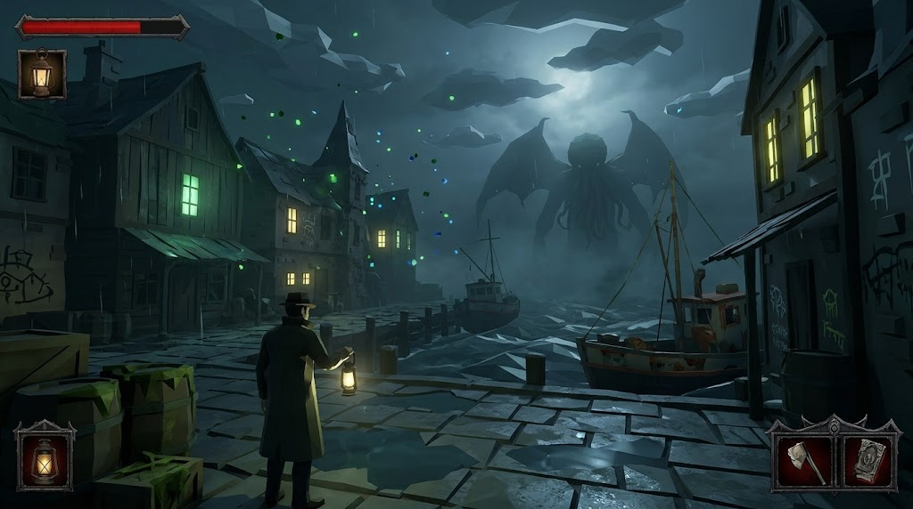
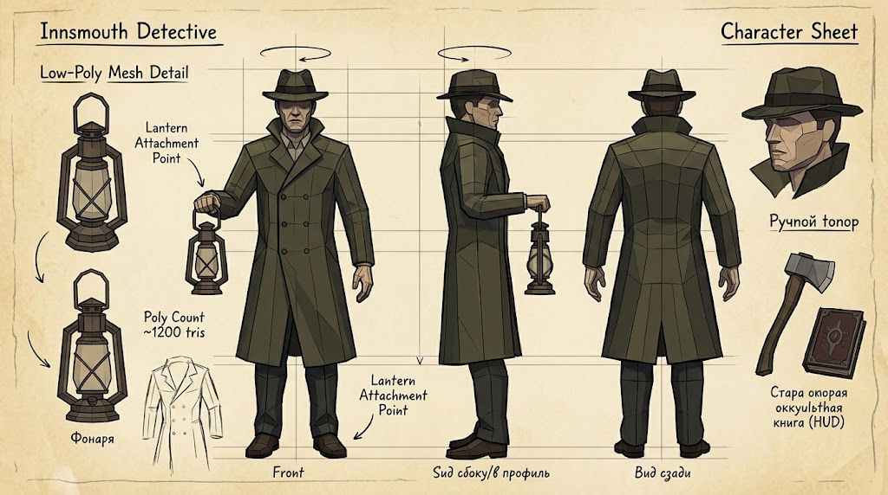

# Farm Love Craft

## Референсы стиля, атмосферы и духа игры

Ниже закреплены ключевые визуальные референсы проекта, определяющие художественный стиль (граненый **Low-Poly / Retro PS1**, выразительные силуэты, контрастное освещение керосинового фонаря во мраке Иннсмута/Аркхэма) и дизайн главного героя — **Сыщика (Innsmouth Detective)**.

### 1. Атмосфера и дух мира (Набережная Иннсмута и силуэт Ктулху)

* **Окружение и настроение**: Ночной портовый город с угловатой низкополигональной архитектурой, мокрой каменной брусчаткой, туманом, зеленоватым биолюминесцентным свечением спор/ихора в окнах и гигантским силуэтом Древнего (Ктулху) в грозовых облаках над заливом.
* **Свет и контраст**: Холодная иссиня-болотная гамма ночного шторма прорезается теплым янтарным светом керосинового фонаря в руке сыщика.

### 2. Концепт-лист главного героя (Innsmouth Detective — Character Sheet)

* **Детализированная полигональная сетка (`detective.glb` — 1 498 вершин, 1 394 грани / 2 760 треугольников)**:
  * **Тренчкот (плащ)**: Оливково-болотный двубортный плащ ниже колен с четкими вертикальными гранями, поднятым штормовым воротником, широкими лацканами, погонами, поясом с пряжкой, 6 пуговицами, манжетами и задней кокеткой со шлицей.
  * **Голова и шляпа**: Скульптурное граненое лицо с выраженными скулами, волевым подбородком, носом с горбинкой и глубокой тенью глазниц под полями классической фетровой шляпы-федоры с темной лентой и продольной ложбинкой на тулье.
  * **Керосиновый фонарь**: Трубчатый штормовой фонарь («летучая мышь») с двумя боковыми воздуховодами, перекрестной защитной решеткой, верхним куполом-дефлектором и теплым светящимся стеклянным колпаком в правой руке.
  * **Брюки и обувь**: Темно-графитовые брюки со стрелками и кожаные темно-коричневые ботинки с выраженным рантом и каблуком.

## Иерархия предметов (ресурсов)

| Название | Описание                          |     |
| -------- | --------------------------------- | --- |
| Страхи   | Основная валюта                   |     |
| Дерево   | Используется для строительства    |     |
| Металл   |                                   |     |
| Земля    | Используется для высадки растений |     |
| Зацепки  | Улики, основная валюта            |     |

## Иерархия фермы

| Название | Описание                                        | Что требуется для строительства | Что производит |
| -------- | ----------------------------------------------- | ------------------------------- | -------------- |
| Щупальца | Высаживаются в проточной воде, производят страх | Вода, земля, саженцы щупалец    |                |

## Иерархия скилов

| Название | Описание |
| -------- | -------- |
|          |          |

## Объекты Лавкрафтовского Замка (PS1 Detailed Gothic Kit — Реалистичный масштаб под рост сыщика 1.90 м)

Все модели созданы в Blender с высокой детализацией (фаски, восьмигранные колонны, балясины, рельефная кладка, черепа, свитки, щупальца и светящиеся руны), отмасштабированы под реальный человеческий рост (1.90 м) и экспортированы в `assets/models/castle/`:

| Категория | Имя файла | Габариты (Ш×Г×В) | Полигоны | Назначение и описание |
| --------- | --------- | ---------------- | -------- | --------------------- |
| Архитектура | `castle_floor.glb` | 4.00 × 4.00 × 0.11 м | 532 | Модульная каменная плита пола с фасками, мхом в швах и латунно-изумрудным оккультным медальоном |
| Архитектура | `castle_wall.glb` | 4.02 × 0.69 × 4.42 м | 752 | Высокая готическая стена с деревянными панелями (wainscoting), пилястрами, рустованной кладкой и карнизом |
| Архитектура | `castle_pillar.glb` | 1.20 × 1.20 × 4.61 м | 158 | Пучковая восьмигранная колонна с четырьмя полуколоннами, латунными кольцами и светящимися рунами |
| Архитектура | `castle_arch.glb` | 4.00 × 0.86 × 4.44 м | 730 | Стрельчатый готический портал (высота проема ~3.0 м) с замковым камнем и кованой решеткой (portcullis) |
| Мебель | `castle_table.glb` | 2.87 × 1.55 × 1.24 м | 874 | Большой стол исследователя на точеных балясинах с ящиками, багровой дорожкой, «Некрономиконом», черепом и свечами |
| Мебель | `castle_chair.glb` | 0.82 × 0.76 × 2.10 м | 616 | Высокое готическое кресло-трон с каретной стяжкой, мягкими подлокотниками и шпилями |
| Мебель | `castle_bookcase.glb` | 2.52 × 0.70 × 3.64 м | 1312 | Высокий библиотечный шкаф с нижними дверцами, колоннами, фронтоном, ~30 фолиантами, черепом и светящейся сферой |
| Декор / Ритуал | `castle_rug.glb` | 4.67 × 3.02 × 0.05 м | 308 | Большой ритуальный ковер с бахромой, угловыми золотыми медальонами и восьмилучевой октаграммой |
| Освещение | `castle_candelabra.glb` | 1.05 × 0.86 × 2.31 м | 436 | Высокий пятирожковый кованый канделябр на лапах с латунными чашечками и 5 свечами |
| Ритуал | `castle_altar.glb` | 2.38 × 2.38 × 2.82 м | 284 | Восьмигранный жертвенный алтарь со светящейся чашей, обелисками и статуей Ктулху (щупальца и крылья) |
| Интерьер / Очаг | `castle_fireplace.glb` | 3.53 × 1.42 × 4.07 м | 440 | Монументальный каменный камин с кованой решеткой, дровами, тлеющими углями, пламенем и оккультным барельефом |
| Лаборатория | `castle_alchemy.glb` | 2.69 × 1.23 × 1.74 м | 478 | Алхимический верстак с перегонным кубом (ретортой), колбами, весами и банкой с заспиртованным щупальцем |
| Интерьер | `castle_clock.glb` | 0.95 × 0.72 × 3.54 м | 264 | Высокие готические напольные часы со стеклянной витриной, маятником, гирями и лунным циферблатом |

## Уличные объекты и здания города Аркхэма / Иннсмута (PS1 Detailed Outdoor Kit)

Все здания и уличные объекты приведены к полноценному жилому масштабу (высота этажа ~3.8–4.2 м, двери ~3.1 м) и экспортированы в `assets/models/outdoor/`:

| Категория | Имя файла | Габариты (Ш×Г×В) | Полигоны | Назначение и описание |
| --------- | --------- | ---------------- | -------- | --------------------- |
| Уличная мебель | `outdoor_bench.glb` | 2.47 × 0.93 × 1.61 м | 512 | Просторная викторианская садовая скамейка с гнутыми чугунными ножками, завитками подлокотников и готическим гребнем |
| Освещение | `outdoor_lamppost.glb` | 1.44 × 0.92 × 4.65 м | 216 | Высокий газовый уличный фонарь с каннелированным столбом, перекладиной лестницы и шестигранным светильником |
| Флора | `outdoor_tree.glb` | 6.00 × 5.20 × 8.94 м | 372 | Вековой болотный дуб с 5 корнями, крученым стволом, трутовиками, светящимся дуплом и раскидистой кроной |
| Флора | `outdoor_bush.glb` | 2.33 × 2.08 × 1.62 м | 261 | Крупный терновый болотный кустарник с ветвями и гроздьями светящихся фиолетово-изумрудных спор |
| Ограждение | `outdoor_fence.glb` | 4.18 × 0.72 × 2.82 м | 770 | Высокая кованая кладбищенская ограда с рустованными каменными столбами, урнами, кольцами и пиками |
| Ограждение | `outdoor_gate.glb` | 4.80 × 1.35 × 4.82 м | 514 | Монументальные кованые ворота поместья с рустованными пилонами, фонарями и полуоткрытыми створками |
| Мистика / Погост | `outdoor_gravestone.glb` | 1.62 × 1.13 × 2.48 м | 148 | Высокое кельтское готическое надгробие с каменным нимбом, светящимся руническим крестом и черепом |
| Ферма / Ритуал | `outdoor_well.glb` | 2.73 × 2.73 × 3.84 м | 846 | Восьмигранный каменный колодец с воротом, ведром на цепи и 3 изгибающимися щупальцами с присосками |
| Ландшафт | `outdoor_path.glb` | 3.03 × 2.96 × 0.09 м | 234 | Крупная секция мощеной дорожки из 9 рельефных камней с фасками и мхом |
| Руины / Ритуал | `outdoor_gazebo.glb` | 6.11 × 6.11 × 5.48 м | 204 | Затопленная циклопическая ротонда-святилище с расколотыми колоннами, руническим полом и парящим монолитом |
| Ферма / Урожай | `outdoor_cart.glb` | 2.33 × 4.11 × 1.79 м | 282 | Полноразмерная деревянная телега на колесах со спицами, бочкой, ящиком и собранным урожаем спор и щупалец |
| Город / Площадь | `outdoor_fountain.glb` | 5.31 × 5.31 × 4.49 м | 268 | Большой городской фонтан с бронзовыми маскаронами-гаргульями, изумрудной водой и обелиском со щупальцами |
| Город / Декор | `outdoor_kiosk.glb` | 1.99 × 1.99 × 4.20 м | 286 | Высокая чугунная афишная тумба с медным куполом, объявлениями «Arkham Gazette» и оккультными листовками |
| Погост / Склеп | `outdoor_crypt.glb` | 4.56 × 5.21 × 5.88 м | 412 | Полноразмерный каменный склеп-мавзолей с колоннами портика, контрфорсами, решетчатыми вратами и черепом |
| Канал / Мост | `outdoor_bridge.glb` | 3.57 × 5.10 × 1.54 м | 594 | Широкий горбатый каменный мост через канал с парапетами, балясинами и руническими навершиями |
| Канал / Ферма | `outdoor_canal.glb` | 5.00 × 4.03 × 0.98 м | 396 | Секция каменного проточного канала с биолюминесцентным течением и высаженными в воде ростками щупалец |
| Город / Дом | `outdoor_townhouse.glb` | 8.68 × 8.19 × 11.80 м | 600 | Полноразмерный двухэтажный фахверковый особняк с мансардой, кирпичным первым этажом, эркером и дымоходом |
| Город / Лавка | `outdoor_shop.glb` | 7.91 × 7.93 × 9.43 м | 386 | Двухэтажное здание оккультной аптекарской лавки с витринами, полузаколоченными ставнями и вывеской |
| Город / Гостиница | `outdoor_inn.glb` | 9.29 × 8.83 × 10.68 м | 514 | Большая гостиница и таверна «Gilman House» с крытой верандой, балконом второго этажа, фонарями и вывеской |
| Доки / Промзона | `outdoor_warehouse.glb` | 9.10 × 7.52 × 10.60 м | 372 | Крупный портовый склад «Компании Марша» на каменных сваях с балкой-лебедкой, сетью, трубой и чаном со щупальцем |
| Город / Университет | `outdoor_university.glb` | 11.52 × 9.59 × 12.71 м | 1006 | Монументальный корпус Библиотеки и Обсерватории Мискатоникского Университета с портиком, куполом и телескопом |
| Город / Собор | `outdoor_church.glb` | 10.55 × 12.73 × 17.46 м | 902 | Величественный неоготический собор «Тайного Ордена Дагона» с колокольней, контрфорсами, окном-розой и шпилем |
| Город / Доминанта | `outdoor_clocktower.glb` | 4.76 × 4.76 × 15.41 м | 534 | Высокая городская часовая башня Аркхэма с контрфорсами, 4 светящимися циферблатами и медным шпилем |
| Транспорт 1920-х | `outdoor_carriage.glb` | 2.76 × 5.14 × 2.96 м | 658 | Полноразмерный винтажный автомобиль-катафалк 1920-х со спицованными колесами, фарами и реликварием в кузове |
| Город / Декор | `outdoor_phonebooth.glb` | 1.51 × 1.51 × 3.24 м | 264 | Уличная телефонная будка 1920-х годов (в полный человеческий рост с запасом) с теплым светом и медным куполом |

